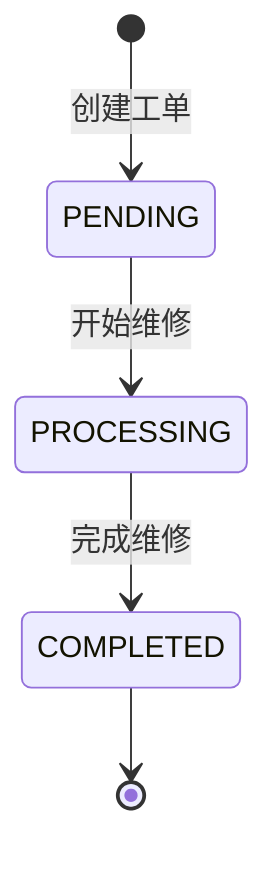
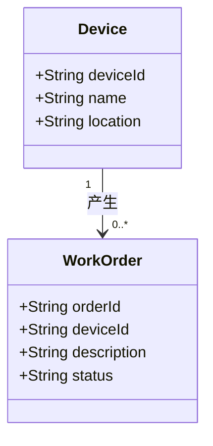

# 状态图与简单类图

## 状态图

状态规则：

- 新工单初始状态为 `PENDING`（待处理）。
- 只允许 `PENDING → PROCESSING` 和 `PROCESSING → COMPLETED`。
- 跳级、回退、相同状态以及其他转换均拒绝。
- `COMPLETED`（已完成）是本次业务终态，不设置撤销或重新打开。

## 简单类图

- 一台设备可以对应 0 到多张工单，每张工单必须对应 1 台设备。
- `WorkOrder.status` 取值为 `PENDING`、`PROCESSING` 或 `COMPLETED`。
- 本实验仅分析类结构，不要求编写 `Device` 和 `WorkOrder` 实体类。

## 与需求的一致性检查

- [x] 中文状态与程序英文值对应
- [x] 只允许两条转换
- [x] 一台设备与多张工单关系清楚
- [x] 状态图和类图与 FR-01 至 FR-03 一致
