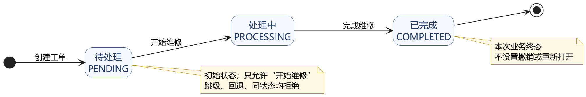
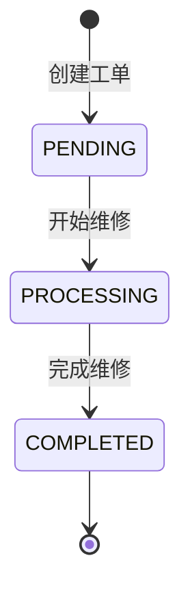
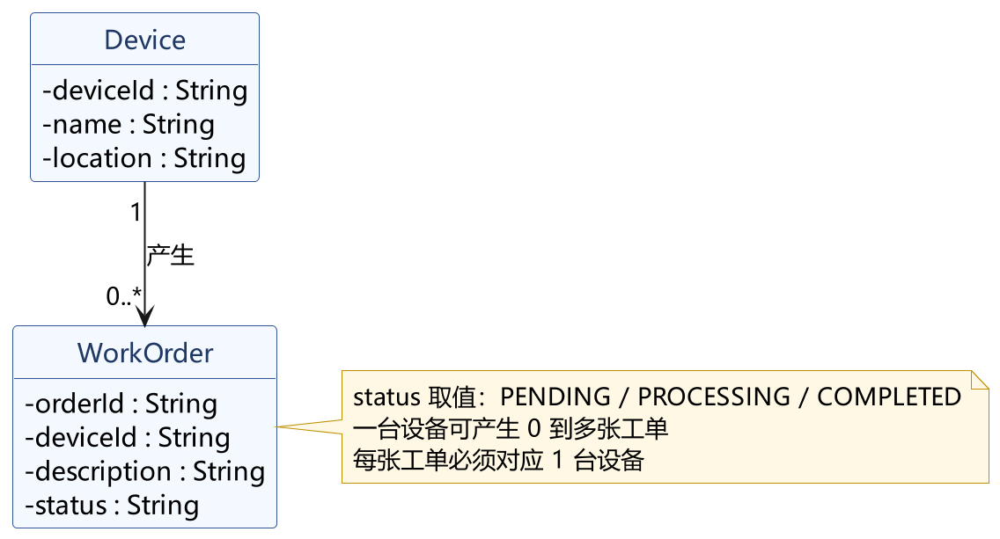
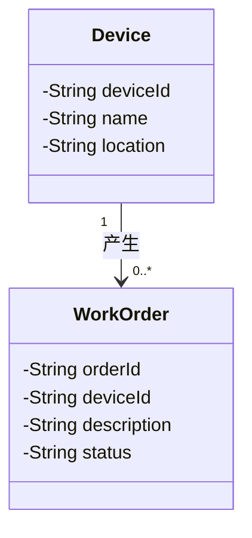

# 状态图与简单类图

> 负责人：B（GitHub：Esponjs）　分支：`docs/models-b`　对应需求：FR-01～FR-03
>
> 图片与可编辑源文件均放在 `docs/assets/`，本文使用相对路径引用，不使用本机磁盘路径。

## 1 工单状态图

### 1.1 图形

- 可编辑源文件：[state.puml](assets/state.puml)（PlantUML）；[state.svg](assets/state.svg)（矢量图）。
- 同一模型的 Mermaid 写法见 1.2，便于在 GitHub 网页直接预览。

### 1.2 Mermaid 源

### 1.3 状态说明

| 状态 | 中文名称 | 含义 | 进入条件 | 离开条件 |
| --- | --- | --- | --- | --- |
| `PENDING` | 待处理 | 工单已创建，尚未开始维修 | 报修人提交报修并创建工单 | 仅“开始维修”事件，转入 `PROCESSING` |
| `PROCESSING` | 处理中 | 维修人员已开始维修 | “开始维修”事件 | 仅“完成维修”事件，转入 `COMPLETED` |
| `COMPLETED` | 已完成 | 维修结束，本次业务终态 | “完成维修”事件 | 无；不设置撤销或重新打开 |

状态图只包含三个业务状态和两个伪状态（初始 `[*]`、终止 `[*]`）。初始伪状态通过“创建工单”进入 `PENDING`，`COMPLETED` 通过终止伪状态结束，因此图中不存在“重新打开”一类的回退路径。

### 1.4 事件与转换

| 事件 | 源状态 | 目标状态 | 说明 |
| --- | --- | --- | --- |
| 创建工单 | 初始伪状态 | `PENDING` | 报修成功，工单初始状态固定为待处理（FR-02） |
| 开始维修 | `PENDING` | `PROCESSING` | 维修人员接单并开始维修（FR-03） |
| 完成维修 | `PROCESSING` | `COMPLETED` | 维修结束，工单进入终态（FR-03） |

### 1.5 状态转换矩阵

| 当前状态 \ 目标状态 | `PENDING` | `PROCESSING` | `COMPLETED` |
| --- | --- | --- | --- |
| `PENDING` | 拒绝（同状态） | **允许**（开始维修，T01） | 拒绝（跳级，T03） |
| `PROCESSING` | 拒绝（回退） | 拒绝（同状态） | **允许**（完成维修，T02） |
| `COMPLETED` | 拒绝（回退） | 拒绝（回退，T04） | 拒绝（同状态） |

矩阵中只有两个“允许”单元，与 FR-03、状态图以及 `src/python/status_rule.py` 中的两条白名单规则完全对应。跳级、回退、同状态及其余组合一律拒绝，拒绝的转换不画成箭头，只在矩阵和注释中说明，避免读者把“拒绝的转换”误读成“允许的路径”。

## 2 设备与工单简单类图

### 2.1 图形

- 可编辑源文件：[class.puml](assets/class.puml)（PlantUML）；[class.svg](assets/class.svg)（矢量图）。

### 2.2 Mermaid 源

### 2.3 类与属性说明

| 类 | 属性 | 类型 | 说明 |
| --- | --- | --- | --- |
| `Device` | `deviceId` | String | 设备编号，清单内唯一，例如 `DEV-001`；FR-01 按它查询 |
| `Device` | `name` | String | 设备名称，例如“温湿度传感器”；FR-01 要求显示 |
| `Device` | `location` | String | 安装位置，例如“A101 教室”；FR-01 要求显示 |
| `WorkOrder` | `orderId` | String | 工单编号，创建工单时生成 |
| `WorkOrder` | `deviceId` | String | 关联的设备编号，取值为 `Device.deviceId` |
| `WorkOrder` | `description` | String | 报修人填写的故障描述，非空（FR-02） |
| `WorkOrder` | `status` | String | 工单状态，仅取 `PENDING`、`PROCESSING`、`COMPLETED` |

### 2.4 关联与多重性

- `Device "1" --> "0..*" WorkOrder`：**一台设备可以产生 0 到多张工单；每张工单必须且只能对应 1 台设备**。
- 关联方向由设备指向工单，语义是“设备产生工单”；外键为 `WorkOrder.deviceId`。
- 设备刚录入、尚未报修时为 0 张工单，因此 `WorkOrder` 一侧的下界是 `0`；工单不能脱离设备存在，因此 `Device` 一侧固定为 `1`。
- `WorkOrder.status` 的取值与状态图一致；本实验只分析结构，不要求编写 `Device`、`WorkOrder` 实体类。

## 3 与需求的一致性检查

| 需求 | 检查点 | 模型中的体现 | 结论 |
| --- | --- | --- | --- |
| FR-01 查看设备 | 能按编号返回编号、名称和位置 | `Device` 含 `deviceId`、`name`、`location` 三个属性 | 一致 |
| FR-02 提交报修 | 保存设备和故障描述，初始状态为 `PENDING` | `WorkOrder.deviceId`、`WorkOrder.description`；初始伪状态经“创建工单”进入 `PENDING` | 一致 |
| FR-03 更新状态 | 只允许两条转换，其余拒绝 | 状态图只有 `PENDING→PROCESSING`、`PROCESSING→COMPLETED` 两条箭头；转换矩阵其余单元均为拒绝 | 一致 |
| 用例图 | 两个参与者、三个用例，角色权限不越界 | 状态图不出现参与者；类图不把数据库或设备画成操作者；开始/完成维修只由维修人员触发 | 一致 |
| 状态命名 | 中文名称与程序值一一对应 | 待处理=`PENDING`、处理中=`PROCESSING`、已完成=`COMPLETED` | 一致 |

自查清单：

- [x] 初始状态为 `PENDING`，终态为 `COMPLETED`，没有撤销、重新打开等额外状态
- [x] 只画两条允许转换，跳级、回退、同状态均拒绝
- [x] 一台设备对应 0 到多张工单，每张工单对应 1 台设备，多重性标注清楚
- [x] 图片使用相对路径引用，源文件与导出图内容一致

## 4 建模过程中发现并处理的问题

1. **初始状态容易画错。** 初稿把“创建工单”画成 `PENDING` 出发的自转换，读起来像“待处理可以再次创建工单”。核对 FR-02 后改为从初始伪状态 `[*]` 经“创建工单”进入 `PENDING`，`PENDING` 只保留“开始维修”一条出边。
2. **同状态转换没有画成自环。** FR-03 明确同状态转换也要拒绝，若画自环会被误认为允许，因此在图中省略自环，改在 1.5 的矩阵中标注“拒绝（同状态）”。
3. **类图初稿缺少多重性。** 只画了关联线，没有写 `1` 和 `0..*`，无法说明“一台设备对应多张工单”。补充两端多重性，并注明 `WorkOrder.deviceId` 为外键后才与 FR-01、FR-02 对齐。
4. **中文状态与程序值需要固定对应。** 在文档中统一写成“中文（程序值）”的形式，保证状态图、类图属性说明和 C 的状态判断函数使用同一套取值。
