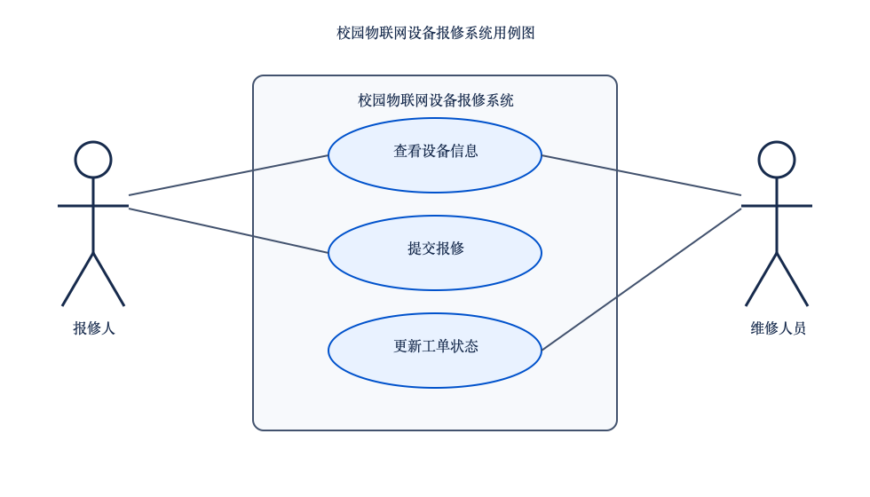

# 用例图与角色说明

## 用例图

可编辑源文件：[usecase.puml](assets/usecase.puml)

## 角色说明

- **报修人**：查看设备信息；选择清单内设备并提交报修。
- **维修人员**：查看设备信息；开始维修（`PENDING → PROCESSING`）；完成维修（`PROCESSING → COMPLETED`）。

## 用例说明

| 用例 | 参与者 | 结果 |
| --- | --- | --- |
| 查看设备信息 | 报修人、维修人员 | 显示设备编号、名称和位置；编号不存在时提示 |
| 提交报修 | 报修人 | 校验设备和故障描述，创建初始状态为 `PENDING` 的工单 |
| 更新工单状态 | 维修人员 | 仅允许两条规定状态转换，其余转换拒绝 |

## 图的自查

- [x] 两个参与者
- [x] 三个主要用例
- [x] 系统边界清楚
- [x] 参与者与用例连接正确
- [x] 源文件与导出图内容一致

## A 提交检查

- 负责人：A（`yokeres`）
- 提交日期：2026-11-06
- 检查结论：`usecase.png` 用于直接查看，`usecase.puml` 作为可编辑源文件；二者均包含两个参与者、系统边界和三个用例。
